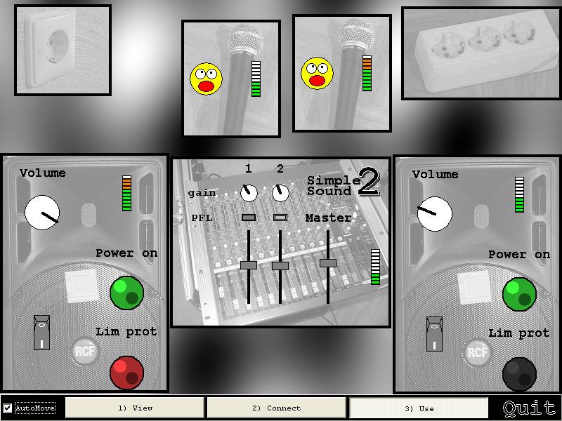

# SimStagecraft

[Go to the nicely rendered website](https://richelbilderbeek.github.io/SimStagecraft/).

[](https://github.com/richelbilderbeek/SimStagecraft/actions/workflows/build_qt.yaml)

Tool to simulate stagecraft (connecting sound and light) using C++ and Qt.
The original version (still in the git history) used the C++ Builder VCL library.

## Build

Requires CMake and Qt 6. On Ubuntu:

```
sudo apt install qt6-base-dev cmake
cmake -S . -B build
cmake --build build
./build/SimStagecraft
```

Run the smoke test with `ctest --test-dir build` (set `QT_QPA_PLATFORM=offscreen` when there is no display).

 * [Download the Windows executable](http://richelbilderbeek.nl/ToolSimStagecraftExe.zip)
 * Video's: [YouTube](https://youtu.be/qvfJYq54BUI) [.ogv](http://richelbilderbeek.nl/sim_stagecraft.ogv)

